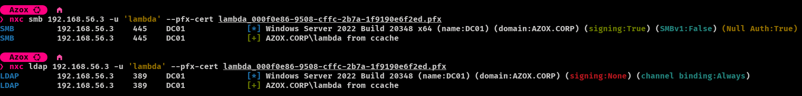
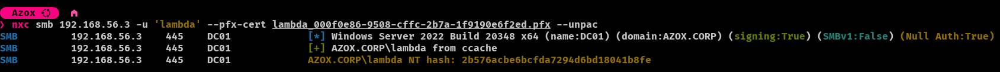
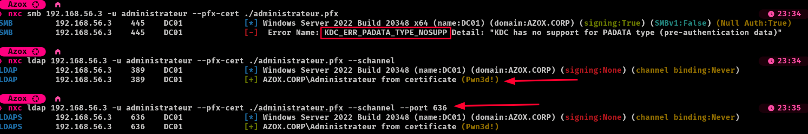

# Using Certificates

## PKINIT (default)

By default, nxc authenticates with the certificate through **PKINIT**: it asks the KDC for a TGT with the certificate, saves it to a ccache, then performs a regular Kerberos login with that ticket (`from ccache`). It works on every protocol, but requires the KDC to support PKINIT: the Domain Controller must hold a certificate with the **KDC Authentication** EKU (`1.3.6.1.5.2.3.5`), issued by a CA present in the NTAuth store.

```bash
nxc smb 192.168.0.1 --pfx-cert user.pfx -u user 
```

```bash
nxc smb 192.168.0.1 --pfx-cert user.pfx --pfx-pass password -u user 
```

```bash
nxc smb 192.168.0.1 --pfx-base64 user.pfx -u user 
```

```bash
nxc smb 192.168.0.1 --pem-cert user.pem --pem-key key.pem -u user 
```

<figure><figcaption><p>PKINIT authentication with a PFX certificate over SMB and LDAP</p></figcaption></figure>


When authenticating with a certificate, nxc saves the TGT to a ccache file in `~/.nxc/logs/`. You can reuse this ccache to authenticate with Kerberos in other tools (`KRB5CCNAME=<file>.ccache`).



If the KDC cannot be resolved from the domain name, specify the Domain Controller IP with `--kdcHost`.


### UnPAC the hash (SMB only)

The login itself is done with Kerberos, so the NT hash of the account is no longer retrieved by default. With `--unpac`, nxc additionally performs a U2U request with the PKINIT TGT and extracts the NT hash of the account from the `PAC_CREDENTIAL_INFO` structure of the PAC. The hash is displayed and stored in the nxc database.

```bash
nxc smb 192.168.56.3 -u lambda --pfx-cert lambda.pfx --unpac
```

<figure><figcaption><p>Recovering the NT hash of the account with --unpac</p></figcaption></figure>


`--unpac` only works with the **smb** protocol and requires a certificate (`--pfx-cert`, `--pfx-base64` or `--pem-cert` / `--pem-key`). The **winrm** protocol has no Kerberos login: it always unPACs the hash and authenticates over NTLM with it.


#### References



## Schannel (LDAP only)

When the Domain Controller has no such certificate, PKINIT is unavailable and the authentication fails with `KDC_ERR_PADATA_TYPE_NOSUPP`. With `--schannel`, the certificate is presented directly in the TLS handshake and the bind is done with a SASL `EXTERNAL` bind: Kerberos is never involved, so it still works in that case.

```bash
nxc ldap 192.168.56.3 --pfx-cert ./administrateur.pfx --schannel
```

```bash
nxc ldap 192.168.56.3 --pfx-cert ./administrateur.pfx --schannel --port 636
```

```bash
nxc ldap 192.168.56.3 --pem-cert user.pem --pem-key key.pem --schannel
```

<figure><figcaption><p>PKINIT fails on a DC without KDC certificate, while Schannel authenticates over LDAP and LDAPS</p></figcaption></figure>


The account is resolved by the Domain Controller from the certificate mapping, so no username is needed: nxc retrieves the mapped account with an LDAP `whoami` and displays it (`AZOX.CORP\Administrateur from certificate`). Any `-u` value is ignored.



`--schannel` only works with the **ldap** protocol, and requires one of `--pfx-cert`, `--pfx-base64` or `--pem-cert` / `--pem-key`. Since no Kerberos ticket, password or hash is obtained, features that need a secret (SMB access, modules reading SYSVOL, etc.) are not available.

