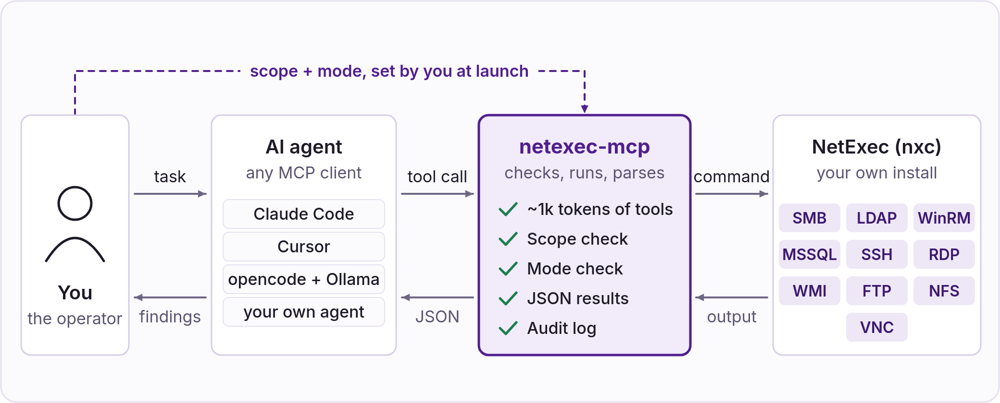

# NetExec MCP

<figure><figcaption></figcaption></figure>

**netexec-mcp** is an [MCP](https://modelcontextprotocol.io) server that plugs NetExec directly into an AI agent: Claude Code, Cursor, opencode, or your own. The agent calls NetExec as one of its tools, inside the scope and mode you set.

Why use it instead of letting the agent type `nxc` commands in a shell:

* **Fewer tokens.** The agent sees 5 small meta-tools (about 1k tokens) and looks up the tool it needs, instead of parsing the `nxc` help or NetExec's source code to work out the right command. Small local models fit, and big ones cost less.
* **Scope enforced.** Every target is checked against `NXC_SCOPE`. Anything outside is refused.
* **Actions under control.** `NXC_MODE` decides what the agent may run, from suggesting commands only to full exploitation.
* **Structured results.** Shares, hashes and admin rights come back as JSON fields, not terminal text.
* **Audit log.** Every command, whether it ran, was previewed or was refused, is logged.


netexec-mcp is a companion project by [@mpgn](https://x.com/mpgn_x64), installed separately from NetExec. It covers all ten protocols and NetExec's modules. Source: [github.com/mpgn/netexec-mcp](https://github.com/mpgn/netexec-mcp)


### Install

You need NetExec installed (see Installation).

```bash
pipx install netexec-mcp
# or
uv tool install netexec-mcp
```

On startup the server runs `nxc --version` and refuses to start if NetExec is not found. If `nxc` is not on your `PATH`, set `NXC_COMMAND` (e.g. `NXC_COMMAND="uv run --no-sync --directory /opt/NetExec netexec"`). Keep `--no-sync` when NetExec runs from a source checkout: without it, each nxc call re-syncs NetExec's environment under a lock, so parallel calls run one after another and the server starts more slowly. Run `uv sync` in the checkout after each update.

### Configure

The server is configured with environment variables, passed by your agent (see below).

| Variable             | What it does                                                                                                                                                                                                                     | Default                      |
| -------------------- | -------------------------------------------------------------------------------------------------------------------------------------------------------------------------------------------------------------------------------- | ---------------------------- |
| `NXC_SCOPE`          | **Required.** Allowed targets: IPs, CIDRs, ranges or hostnames, comma-separated. Fail-closed: with no scope, every target is refused.                                                                                            | _none_                       |
| `NXC_MODE`           | `suggest`, `recon`, `loot` or `full` (see below).                                                                                                                                                                                | `recon`                      |
| `NXC_AUDIT_LOG`      | Audit log, one JSON line per command: run, previewed or refused. Strongly recommended.                                                                                                                                           | _none_                       |
| `NXC_PATH`           | NetExec home: `nxc.conf`, workspace databases, logs and retrieved files. Passed on to nxc. Use one per engagement, as an absolute path (see below).                                                                              | `~/.nxc`                     |
| `NXC_COMMAND`        | How to launch NetExec, parsed like a shell command, e.g. `uv run --no-sync --directory ~/NetExec netexec`.                                                                                                                       | `nxc` or `netexec` on `PATH` |
| `NXC_PROTOCOLS`      | Protocols to expose, comma-separated, e.g. `smb,ldap`.                                                                                                                                                                           | all 10                       |
| `NXC_TOOL_MODE`      | `dynamic`: the agent sees 5 meta-tools and looks up the others. `static`: every tool is listed up front, which costs tens of thousands of tokens of context; use it only with a large-context model that should skip the lookup. | `dynamic`                    |
| `NXC_MODULE_CATALOG` | Where dynamic mode finds the `-M` modules: `static` (the list shipped with the server) or `live` (`nxc <proto> -L` at startup, for custom modules or an nxc newer than the list). The mode gate always reads the installed nxc.  | `static`                     |
| `NXC_TIMEOUT`        | Timeout of one call, in seconds.                                                                                                                                                                                                 | `300`                        |
| `NXC_MAX_TARGETS`    | Maximum targets in one call.                                                                                                                                                                                                     | `256`                        |
| `NXC_LOG_DIR`        | One nxc log file per executed call, with the full raw output even when the agent's view of it is capped. Holds secrets: files are created `0600`.                                                                                | _none_                       |
| `NXC_WORKSPACE`      | Workspace the `workspace_*` readers look in. Read side only: nxc keeps writing to the workspace set in its `nxc.conf`.                                                                                                           | `nxc.conf`'s, else `default` |
| `NXC_DOWNLOADS_DIR`  | Where retrieved files land (e.g. `smb_get_file`) when the call gives no absolute path.                                                                                                                                           | `<NXC_PATH>/downloads`       |

Each mode includes the previous one:

| Mode                | What the agent can run                                                        |
| ------------------- | ----------------------------------------------------------------------------- |
| `suggest`           | Nothing. Tools return the `nxc` command they would run, for you to run.       |
| `recon` _(default)_ | Read-only enumeration: hosts, shares, users, groups, policies...              |
| `loot`              | + credential collection: SAM, LSA, NTDS, GPP, Kerberoasting, AS-REP roasting. |
| `full`              | + everything else: command execution, uploads, spraying, coercion, exploits.  |

Scope and mode are read once at startup. The agent cannot change them; to raise them, edit the config and restart the server.

#### Keep the agent's NetExec apart from yours

NetExec keeps its settings, its workspace databases (with every credential it finds), its logs and the files it retrieves in one home folder, `~/.nxc` by default. If the agent shares that folder with you, it can read the credentials of your other engagements, and its results mix with yours. So give the server its own folder with `NXC_PATH`, one per engagement:

```bash
mkdir -p ~/.netexec-mcp/acme
```

```json
"env": {
  "NXC_SCOPE": "10.0.0.0/24",
  "NXC_PATH": "/home/you/.netexec-mcp/acme",
  "NXC_AUDIT_LOG": "/home/you/.netexec-mcp/acme/audit.jsonl"
}
```

The server passes `NXC_PATH` on to every nxc it runs, so everything the agent's calls produce stays in that folder, while your own `nxc` keeps using `~/.nxc`. To look at what the agent found, run your own tools with the same folder, for example `NXC_PATH=$HOME/.netexec-mcp/acme nxcdb`.


* **Create the folder first, and give its full path.** NetExec fills the folder on its first run, but it cannot create a missing parent folder, and it does not expand `~` in `NXC_PATH` (a JSON config does not either, nor do fish and zsh in `-e NXC_PATH=~/...`). In both cases, the server refuses to start with a message about `NXC_COMMAND`.
* **`NXC_WORKSPACE` does not separate engagements.** It only changes the workspace the server reads, while nxc keeps writing to the workspace set in its `nxc.conf`.


### Plug it into your agent



```bash
claude mcp add netexec \
  -e NXC_SCOPE=10.0.0.0/24 \
  -e NXC_MODE=recon \
  -e NXC_PATH=$HOME/.netexec-mcp/acme \
  -e NXC_AUDIT_LOG=$HOME/.netexec-mcp/acme/audit.jsonl \
  -- netexec-mcp
```

Check with `claude mcp list`, or `/mcp` inside Claude Code.



Add to `~/.cursor/mcp.json` (all projects) or `.cursor/mcp.json` (one project):

```json
{
  "mcpServers": {
    "netexec": {
      "command": "netexec-mcp",
      "env": {
        "NXC_SCOPE": "10.0.0.0/24",
        "NXC_MODE": "recon",
        "NXC_PATH": "/home/you/.netexec-mcp/acme",
        "NXC_AUDIT_LOG": "/home/you/.netexec-mcp/acme/audit.jsonl"
      }
    }
  }
}
```



Add to `opencode.json`, next to your Ollama provider:

```json
{
  "$schema": "https://opencode.ai/config.json",
  "mcp": {
    "netexec": {
      "type": "local",
      "command": ["netexec-mcp"],
      "environment": {
        "NXC_SCOPE": "10.0.0.0/24",
        "NXC_MODE": "recon",
        "NXC_PATH": "/home/you/.netexec-mcp/acme",
        "NXC_AUDIT_LOG": "/home/you/.netexec-mcp/acme/audit.jsonl"
      }
    }
  }
}
```

Use a model with solid tool calling (Qwen3 14B is a good start) and at least 32k tokens of context.



**Settings > Developer > Edit Config**, then add to `claude_desktop_config.json` and restart:

```json
{
  "mcpServers": {
    "netexec": {
      "command": "netexec-mcp",
      "env": {
        "NXC_SCOPE": "10.0.0.0/24",
        "NXC_MODE": "recon",
        "NXC_PATH": "/home/you/.netexec-mcp/acme",
        "NXC_AUDIT_LOG": "/home/you/.netexec-mcp/acme/audit.jsonl"
      }
    }
  }
}
```


Desktop apps may not see your shell `PATH`. If the server does not start, use the absolute path of `netexec-mcp` (`which netexec-mcp`) and set `NXC_COMMAND` to the full path of `nxc`.




Any MCP SDK works. With [Pydantic AI](https://github.com/pydantic/pydantic-ai) (`pip install pydantic-ai`):

```python
import os

from fastmcp.client.transports import StdioTransport
from pydantic_ai import Agent
from pydantic_ai.mcp import MCPToolset

netexec = MCPToolset(StdioTransport(
    command="netexec-mcp",
    args=[],
    env={
        "NXC_SCOPE": "10.0.0.0/24",
        "NXC_MODE": "recon",
        "NXC_PATH": os.path.expanduser("~/.netexec-mcp/acme"),  # created beforehand
    },
))

# Any Pydantic AI model works. "ollama:" reads OLLAMA_BASE_URL (e.g. http://localhost:11434/v1)
agent = Agent("ollama:qwen3:14b", toolsets=[netexec])

result = agent.run_sync("Which hosts in scope don't require SMB signing?")
print(result.output)
```




Each action takes about two tool calls (find the tool, then run it). If your agent caps the number of steps per answer, raise it.


### Use it

Ask the agent to "run a NetExec health check": it should answer with your NetExec version and its home folder (`nxc_home`), which should be your `NXC_PATH`. Then give it tasks:

* _"Which hosts in 10.0.0.0/24 don't require SMB signing?"_
* _"With robin / Summer2026!, which shares can I write to?"_
* _"Kerberoast the domain with these credentials."_ (needs `loot`)
* _"Dump LSA on 10.0.0.12 and see if anything lets me move further."_ (needs `loot`, `full` to run commands)


- **One `NXC_PATH` per engagement.** The agent can read credentials stored in NetExec's workspace database, including ones from a previous engagement (see Keep the agent's NetExec apart from yours).
- **Cloud models see your results.** Usernames, hashes and hostnames are sent to the model provider. Use a local model if the rules of engagement require it.
- **For authorized testing only.**


### Learn more

* [netexec-mcp on GitHub](https://github.com/mpgn/netexec-mcp): full configuration and tool list.
* [Building a MCP for NetExec](https://mpgn.fr/building-a-mcp-for-netexec/): the design in depth.
* [You're Building Your MCP Wrong](https://mpgn.fr/youre-building-your-mcp-wrong/): why dynamic mode exists, with benchmarks.
