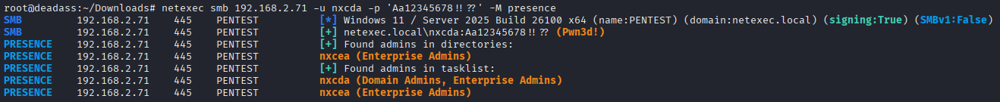
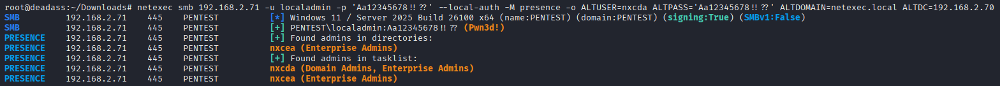

# 🆕 Enumerate DA and EA Group Users' Presence


You need at least local admin privilege on the remote target


This module enumerates Domain Admins and Enterprise Admins group users' presence on a host. When using with local admin, module options and values should be inserted.

With Domain user:

```bash
nxc smb <ip> -u username -p password -M presence
```

<figure><figcaption></figcaption></figure>

With local admin:

```bash
nxc smb <ip> -u username -p password --local-auth -M presence -o ALTUSER=<domain_user> ALTPASS=<domain_pass> ALTDOMAIN=<domain_fqdn> ALTDC=<dc_ip>
```

<figure><figcaption></figcaption></figure>